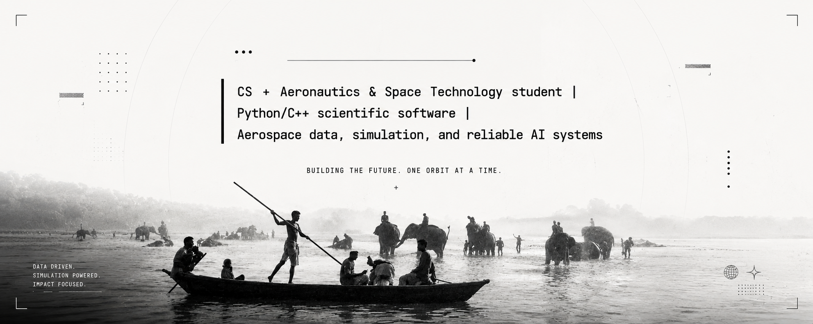

<p align="center">

</p> <p align="center">
  <strong>Engineering some stuff ig ;)</strong>
</p> <p align="center">
  <a href="https://github.com/sundaramvdubey"></a>
  <a href="https://www.linkedin.com/in/sundaramvdubey">
</p>

```
┌──────────────────────────────────────────────────────────────────────────────┐
│  FLIGHT PLAN // SUNDARAM V. DUBEY                                            │
├──────────────────────────────────────────────────────────────────────────────┤
│    Aeronautics & Space Technology + Computer Science                         │
│    IIT Madras & MGKVP                                                        │
│    AI-driven programming, data analytics, and technical learning             │
│    Building systems. Studying models. Following the signal.                  │
│     IIT Mandi 2026 summer                                                    │
│                                                                              │
└──────────────────────────────────────────────────────────────────────────────┘
```

## `01` // About me

I am, **18, a technology enthusiast** working with **aeronautics, space technology, programming, and data**. My academic path combines a **B.S. in Aeronautics and Space Technology at IIT Madras** with Bsc in Computer science from **MGKVP**, completed a AI-driven data analytics and programming through **IIT Mandi**'s Himshikhar program.

I enjoy writing software, exploring datasets, building visual explanations, and learning how complex systems behave. Outside the lab, I am an artist at heart and a reader of fictional worlds. ( i fr im trust me gng )

> **Operating principle:** Excell and larp when you can

## `02` // The Technical Stack


`02.01` // Core Competencies

<p align="left">
  
  
</p>

`02.02` // Expanding Stack ( on my way to learn ) 

<p align="left">
  
</p>

My preferred workflow is deliberately compact: **C and C++** for fundamentals and performance-oriented thinking; **Python** for analysis and experimentation; **NumPy, Pandas, and Matplotlib** for scientific data work; and **Supabase** for practical application backends and structured storage.

## `03` // Featured Expedition

### [Finsight](https://github.com/sundaramvdubey/Finsight)

> **The UPI Growth Story** : a data-driven exploration of fintech strategy, SQL, and financial modelling designed to turn a large-scale payments question into decision-ready insight. ( capstone project @ IIT Mandi)

